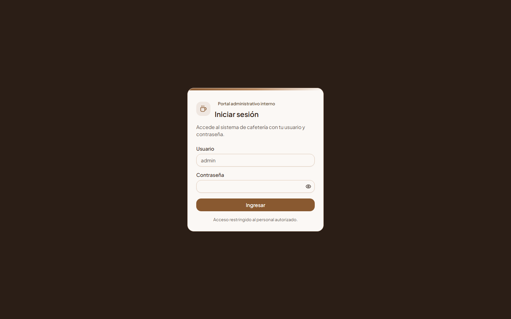
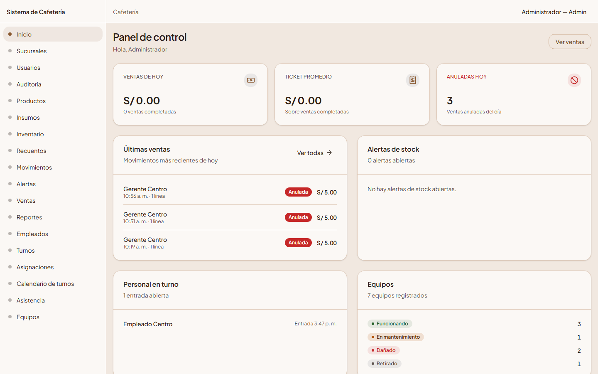
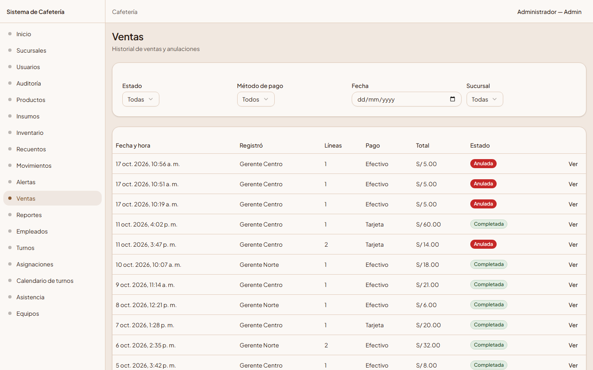
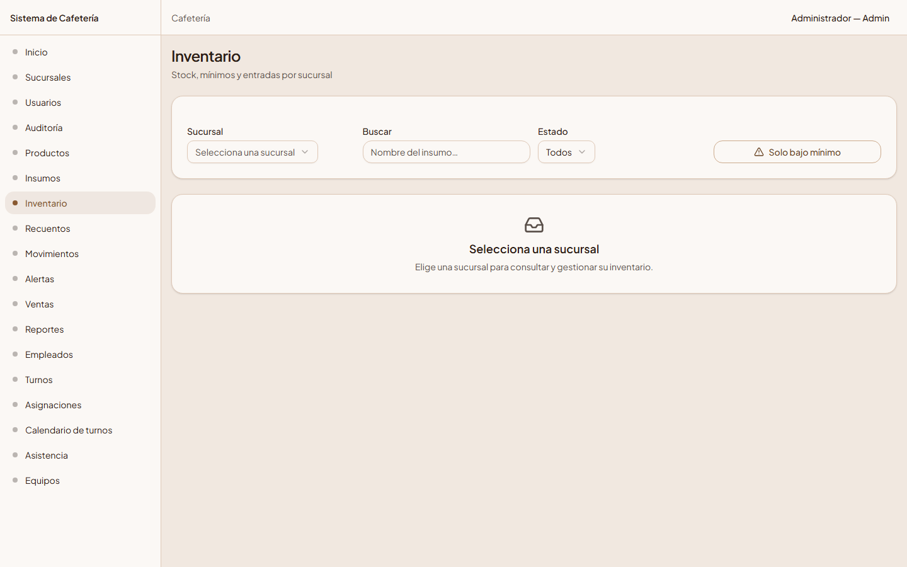
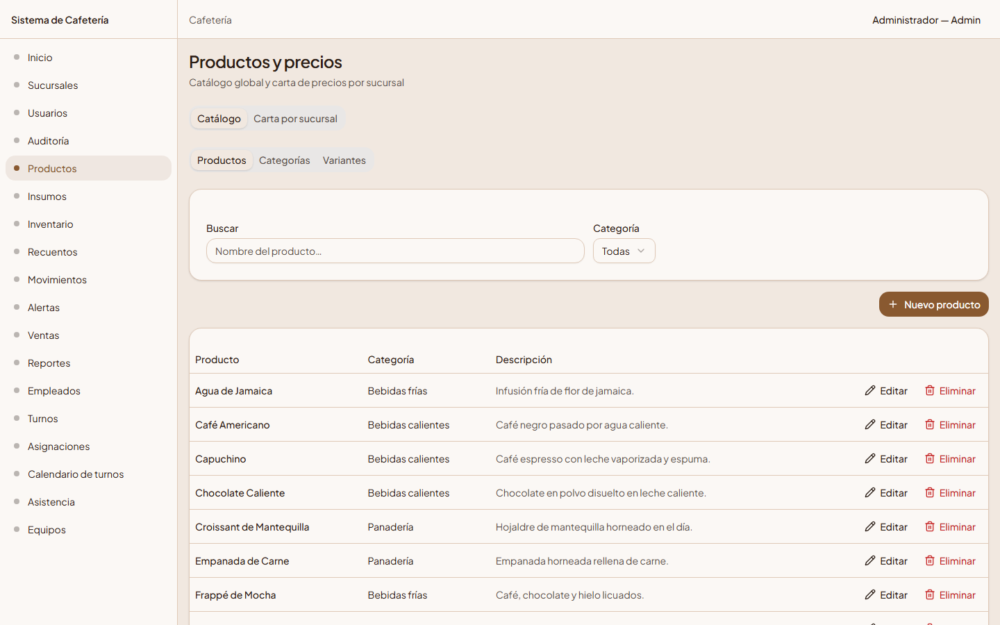
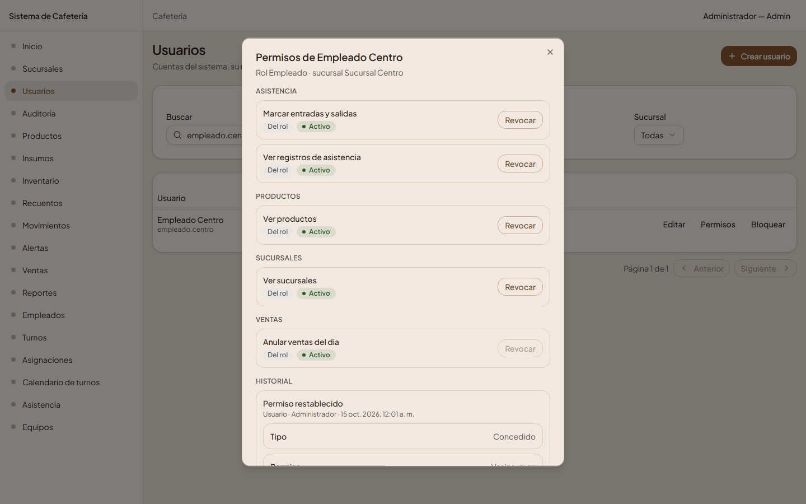
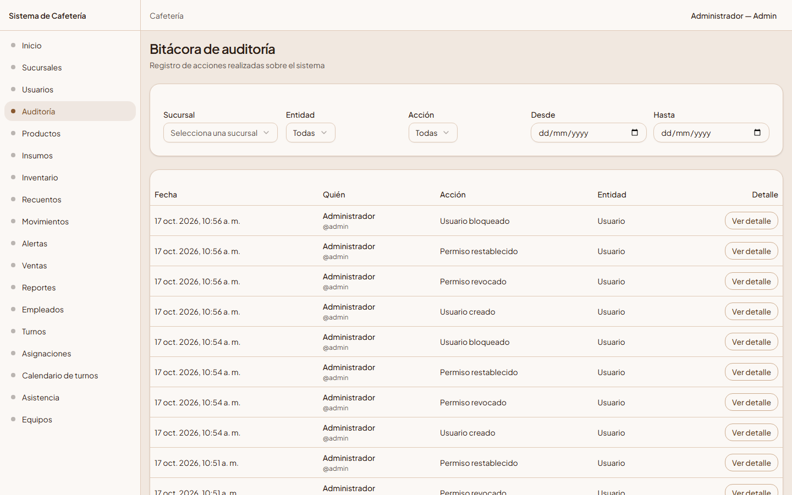
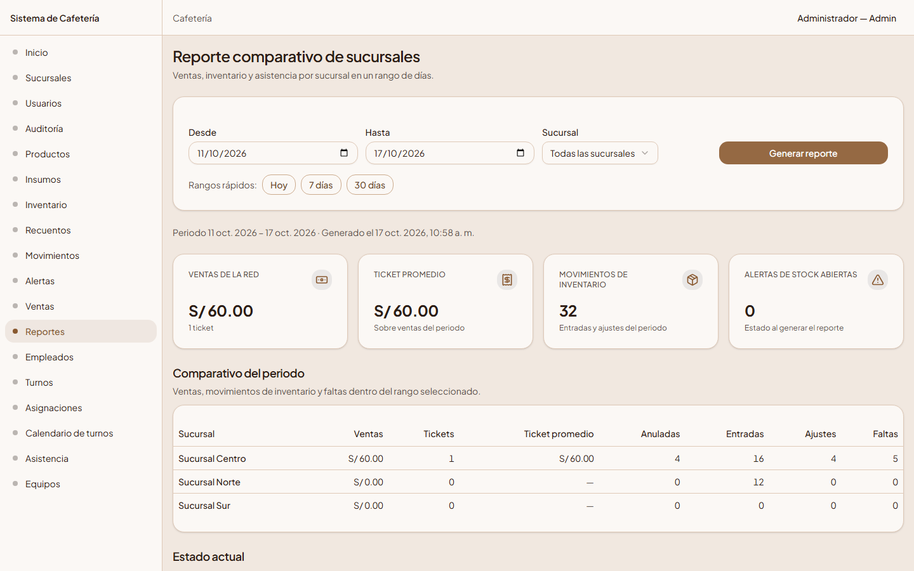
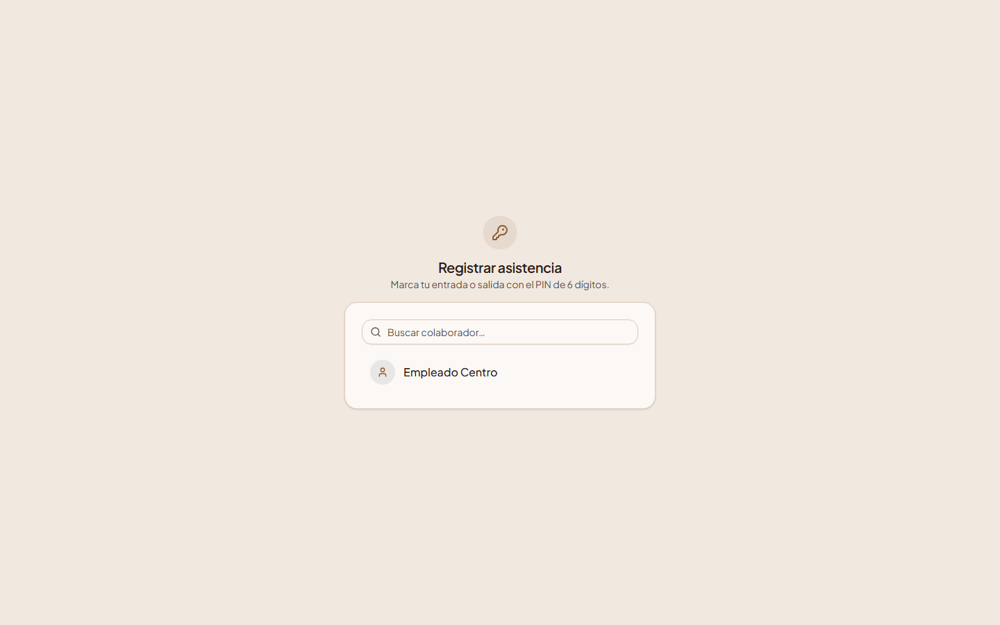
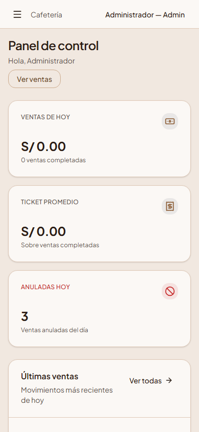

# Cafeteria System

Sistema de gestión para una **cadena de cafeterías con varias sucursales**. Centraliza
en una sola aplicación la operación de cada sede —ventas, catálogo y precios,
inventario con alertas, equipos, personal con turnos y asistencia— y ofrece a la
administración una vista comparativa entre sucursales y una bitácora de auditoría.
Es un **monorepo** con backend (NestJS + Prisma + PostgreSQL), frontend (React + Vite +
TypeScript) y documentación técnica.

## Qué resuelve

- **Ventas de mostrador** con precios congelados en el momento de la venta y anulación
  con motivo el mismo día.
- **Catálogo global** (categorías, variantes y productos) y **precios por sucursal**
  con ofertas activas/inactivas.
- **Inventario de insumos**: stock por sucursal, entradas, recuentos físicos,
  movimientos y **alertas de stock que se abren y cierran solas**.
- **Personal**: usuarios y permisos, equipos por sucursal, empleados con PIN de
  marcación, turnos fijos/variables, asignaciones y **asistencia** (marcación con PIN,
  correcciones, justificación de faltas).
- **Reporte comparativo** entre sucursales (ventas, inventario y asistencia) y una
  **auditoría inmutable** de las operaciones que cambian estado.

## Funcionalidades por módulo

Todos los módulos del backend están implementados y registrados en `AppModule`.

| Módulo       | Qué hace |
| ------------ | -------- |
| `auth`       | Login JWT (8 h), perfil propio y límite de intentos (solo cuenta los fallos). |
| `users`      | Usuarios, roles, alcance por sucursal y permisos individuales con historial. |
| `branches`   | Sucursales: crear, editar y consultar con visibilidad por rol (sin borrado). |
| `products`   | Catálogo global (categorías, variantes, productos) y carta/precios por sucursal. |
| `inventory`  | Insumos, stock, entradas, recuentos, movimientos y alertas automáticas. |
| `sales`      | Registro (precios congelados), consulta y anulación de ventas del mismo día. |
| `equipment`  | Equipos por sucursal con historial de estado y observaciones. |
| `employees`  | Empleados vinculados a un usuario, cargo, cese y PIN de marcación. |
| `shifts`     | Turnos fijos/variables y asignaciones con control de solapamiento. |
| `attendance` | Marcación con PIN, correcciones, justificaciones de faltas y lecturas. |
| `reports`    | Reporte comparativo entre sucursales (ventas, inventario y asistencia). |
| `auditoria`  | Rastro inmutable de cambios (personas, sucursales, equipos, turnos y catálogo) con listado e historial por usuario. |

### Funciones de uso diario

- **Mi horario** (`/my/schedule`): el empleado consulta sus propios turnos de la
  semana (sin permiso de la matriz; solo la ve quien tiene sucursal).
- **Calendario por horas** (`/shifts/calendario-horas`): rejilla semanal estilo
  calendario de móvil (turnos fijos como bloques, variables como etiqueta) para
  Admin y Gerente, con agenda de un día en móvil.
- **Impresión**: el calendario (grupo o individual), el reporte comparativo y
  "Mi horario" se imprimen con cabecera (sucursal, empleado, rango, fecha/hora)
  y una única regla global de impresión.

## Roles y permisos

Tres roles fijos —**Admin** (central, sin sucursal; 20 de los 24 permisos), **Gerente**
(de una sucursal; gestiona Empleados de la suya y fija precios) y **Empleado** (de una
sucursal; puede recibir permisos individuales)— sobre una matriz de **24 permisos**; cada
ruta protegida exige un permiso y el alcance por sucursal se aplica en el caso de uso.
La matriz completa está en [Seguridad y permisos](docs/seguridad-y-permisos.md).

## Stack

- **Backend**: NestJS + TypeScript, Prisma + PostgreSQL 17, `class-validator`,
  `@nestjs/jwt`, `@nestjs/throttler`, validación de entorno con Zod, Swagger y lint con
  oxlint.
- **Frontend**: React 19 + Vite + TypeScript, React Router, TanStack Query,
  React Hook Form + Zod, Tailwind CSS v4 + shadcn/ui, Vitest + Testing Library + MSW,
  ESLint + Prettier.
- **Pruebas de navegador**: Playwright + `@axe-core/playwright` (suite propia, fuera del CI).

## Arquitectura (en pocas líneas)

Monolito modular con NestJS: todo el tráfico pasa por el prefijo `/api`; cada petición
atraviesa, en orden, los guards globales **JWT → permisos → throttling** y el
`ValidationPipe` antes del controlador. Cada módulo (`backend/src/modules/*`) se organiza
en capas **presentation / application / domain / infrastructure**, con las reglas de
negocio puras en `domain` y una transacción local (Prisma) por caso de uso. Los permisos
efectivos se **recalculan en cada petición** contra la base. El frontend es una SPA
independiente que en desarrollo usa el **proxy de Vite** `/api` hacia el backend. Detalle
en [Visión general de la arquitectura](docs/architecture/vision-general.md).

## Capturas

Generadas con datos de demostración (tema claro, etiquetas en español). El conjunto
completo de **21 capturas** vive en [`docs/capturas/`](docs/capturas/).

| | |
| --- | --- |
|  |  |
|  |  |
|  |  |
|  |  |
|  |  |

## Puesta en marcha en local

Requisitos: **Node.js 24** y **PostgreSQL 17** (o el contenedor de `docker-compose.yml`).

```bash
# 1. Base de datos (PostgreSQL 17)
docker compose up -d

# 2. Backend: variables de entorno e instalación
cd backend
Copy-Item .env.example .env        # edita DATABASE_URL, JWT_SECRET y los seeds
npm install

# 3. Migraciones y datos base (3 roles, 24 permisos, 3 sucursales, admin)
npx prisma migrate deploy
npm run db:seed

# 4. Datos de demostración (solo desarrollo; exige el seed base)
npm run db:seed:demo

# 5. Servidor de desarrollo  ->  http://localhost:3000/api  (Swagger en /api/docs)
npm run start:dev
```

```bash
# 6. Frontend (en otra terminal)  ->  http://localhost:5173
cd frontend
Copy-Item .env.example .env
npm ci
npm run dev
```

El **seed de demostración** crea dos sucursales con un usuario por rol. Los cuatro
usuarios comparten la contraseña definida en `SEED_DEMO_PASSWORD` (no se muestra):

| Usuario | Rol | Sucursal |
| ------- | --- | -------- |
| `gerente.centro`  | Gerente  | Sucursal Centro |
| `empleado.centro` | Empleado | Sucursal Centro |
| `gerente.norte`   | Gerente  | Sucursal Norte  |
| `empleado.norte`  | Empleado | Sucursal Norte  |

Los empleados de demostración usan el PIN fijo `246810` (solo entorno local). Los
secretos viven únicamente en archivos `.env` no versionados; nunca se suben al
repositorio. La guía completa (variables, resolución de problemas) está en
[Guía de inicio](docs/guia-de-inicio.md).

> Los seeds **escriben** datos: antes de hacerlo muestran el host y la base y, si el
> destino no es local, exigen confirmación (`npm run db:seed -- --confirm` o
> `SEED_CONFIRMAR_REMOTO=1`). `db:seed:demo` no se ejecuta con `NODE_ENV=production`.

## Despliegue en producción

El repositorio incluye la configuración para un despliegue gratuito:

- **Backend** en [Render](https://render.com) (plan gratuito): [`render.yaml`](render.yaml)
  con `rootDir: backend`, build (`prisma generate` + `migrate deploy` + build), arranque
  y chequeo de salud en `/api/health`.
- **Frontend** en [Netlify](https://netlify.com): [`netlify.toml`](netlify.toml) con build,
  redirección SPA y cabeceras de seguridad.
- **Base de datos** en [Neon](https://neon.com) (serverless).

El backend escucha en `0.0.0.0:$PORT`, usa `TRUST_PROXY=1` (un salto, el proxy de Render),
desactiva Swagger en producción y no tiene ningún secreto con valor por defecto. El
frontend detecta el arranque en frío del plan gratuito y muestra "El servidor está
despertando, puede tardar hasta un minuto" mientras reintenta (~90 s de tope). Paso a paso
en [Despliegue](docs/despliegue.md).

## Pruebas y CI

| Suite | Dónde | Comando |
| ----- | ----- | ------- |
| Unitarias backend | `backend/src/**/*.spec.ts` | `cd backend && npm test` |
| E2E backend (HTTP + base real `*_test`) | `backend/test/*.e2e-spec.ts` | `cd backend && npm run test:e2e` |
| Unitarias/componentes frontend | `frontend/src/**/*.test.tsx` | `cd frontend && npm test` |
| Navegador (Playwright + axe) | `frontend/e2e/specs` | `cd frontend && npm run test:e2e` |

Las pruebas e2e del backend usan una base **aparte** (`cafeteria_test`, se aborta si el
nombre no termina en `_test`):

```bash
docker exec cafeteria-db psql -U cafeteria -d cafeteria_db -c 'CREATE DATABASE cafeteria_test;'
```

La suite **Playwright** maneja la aplicación real con un navegador: necesita el backend y
el frontend arrancados y las variables `VERIF_ADMIN_PASSWORD` / `VERIF_DEMO_PASSWORD` en
el entorno; **no** se ejecuta en CI.

**Integración continua** ([`.github/workflows/ci.yml`](.github/workflows/ci.yml)): en cada
push/PR a `main` corren en paralelo un job de **backend** (`prisma generate`, build, lint,
unitarias y e2e contra un servicio PostgreSQL 17) y un job de **frontend** (`npm ci`, lint,
build con comprobación de tipos y `npm test`). Cifras actuales y detalle de cada suite en
[Estrategia de pruebas](docs/estrategia-de-pruebas.md).

## Documentación

El índice completo está en [docs/README.md](docs/README.md). Documentos destacados:

- [Guía de inicio](docs/guia-de-inicio.md)
- [Despliegue](docs/despliegue.md)
- [Visión general de la arquitectura](docs/architecture/vision-general.md)
- [Seguridad y permisos](docs/seguridad-y-permisos.md)
- [Modelo de datos](docs/modelo-de-datos.md)
- [Referencia de la API](docs/referencia-api.md)
- [Decisiones de diseño](docs/architecture/decisiones-de-diseno.md)
- [Estrategia de pruebas](docs/estrategia-de-pruebas.md)
- [Frontend](docs/frontend.md)

## Limitaciones conocidas y mejoras futuras

- **Ruta para listar usuarios vinculables**: al dar de alta un empleado se vincula un
  usuario existente por `usuarioId`, pero la API no expone un endpoint que devuelva los
  usuarios candidatos a vincular.
- **Idempotencia en recuentos y ventas**: el `POST` de recuento y el de venta no tienen
  clave de idempotencia en el servidor (un doble envío crearía dos registros); se mitiga
  en el frontend deshabilitando el botón durante la petición.
- **Bitácora de accesos y seguridad**: la auditoría cubre operaciones de negocio
  (personas, sucursales, equipos, turnos y catálogo); no registra inicios de sesión ni
  otros eventos de seguridad (el login queda expresamente excluido).
- **Motivo y acta de baja de empleados**: el cese fija la fecha y bloquea la cuenta, pero
  no guarda un motivo ni un acta de baja.
- **Reactivación de empleados**: el cese es definitivo (estado `inactivo`); no hay ruta
  para reactivar a un empleado cesado.
- **Límite de intentos en memoria**: los contadores de login y de PIN viven en la memoria
  del proceso; se reinician al reiniciar el servidor y **no se comparten entre instancias**
  (requiere un almacén compartido para escalar en horizontal).
- **Tokens vigentes tras cambiar la contraseña**: cambiar la contraseña no invalida los
  tokens ya emitidos; siguen válidos hasta expirar.
- **Playwright fuera del CI**: la suite de navegador no se ejecuta en GitHub Actions;
  depende de servidores locales y variables de entorno.

Las reglas que todavía no tienen requisito escrito o prueba dedicada se marcan como
**POR CONFIRMAR** en [Decisiones de diseño](docs/architecture/decisiones-de-diseno.md).

Estas limitaciones y mejoras futuras, ordenadas por prioridad (alta, media y baja), se
recogen en la [Hoja de ruta — Fase 2](docs/hoja-de-ruta-fase-2.md).
